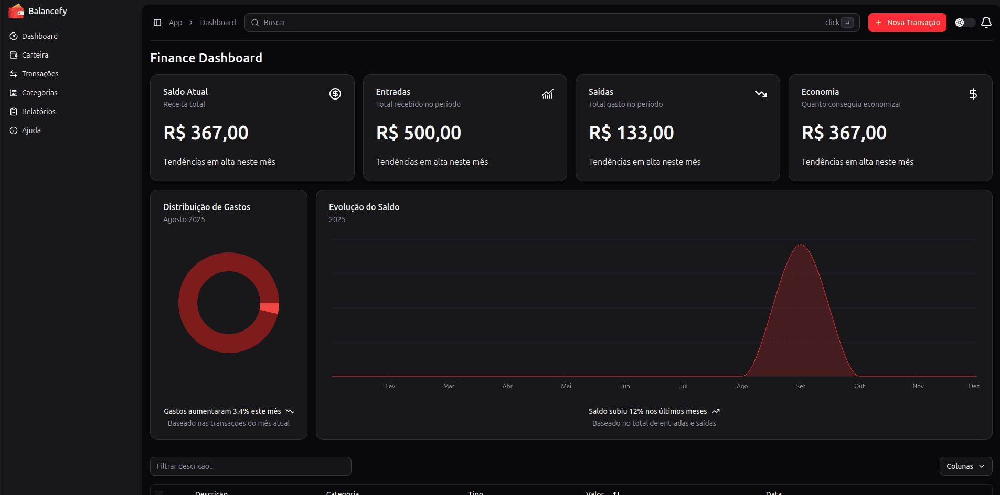

# Balancefy - Personal Finance Dashboard

Web application for personal finance management where users can record income and expenses, organize categories, and track monthly balance evolution with charts.



## Features

- Dashboard with current balance, total income, expenses, and savings
- Transaction management with filtering by description and category
- Expense distribution doughnut chart by category
- Monthly balance evolution line chart
- Responsive dark interface

## Tech Stack

- TypeScript
- React / Next.js
- Tailwind CSS
- Chart.js / Recharts

## Getting Started

1. Clone the repository:
```bash
git clone https://github.com/davyd9/balancefy-finance-web.git
cd balancefy-finance-web
```

2. Install dependencies and run the development server:
```bash
npm install
npm run dev
```

3. Open `http://localhost:3000` in your browser.
